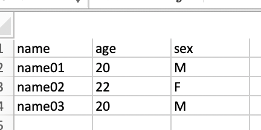
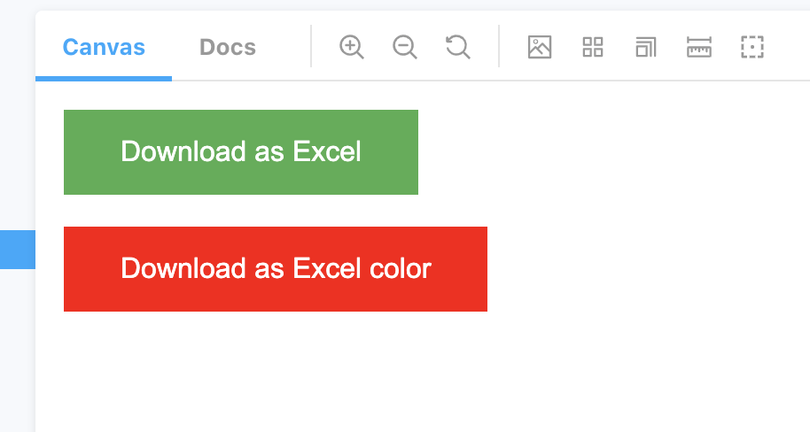

# React json to excel

[](https://nodei.co/npm/react-json-to-excel/)
[]

## Install

```
npm install react-json-to-excel --save
```


## Peer modules

Supports React 18 and 19.

```
npm install file-saver --save
npm install https://cdn.sheetjs.com/xlsx-0.20.3/xlsx-0.20.3.tgz --save
```

The `xlsx` build on npm (0.18.5) has known advisories fixed only in SheetJS's own 0.20.x builds, so installing from the SheetJS CDN is recommended. 0.18.5 still works.

## Migrating to 2.0.0

- `file-saver`/`xlsx` remain peer dependencies; React peer range is now `^18 || ^19`.
- CSS file removed: button styles are inline. `btnClassName` no longer renders `"undefined"` when omitted.
- `fileName` defaults to `download`; `exportToExcel` throws a `TypeError` if `data` is not an array.
- Multi-sheet names are sanitised (invalid characters replaced, max 31 chars, duplicates suffixed).
- Extra props are passed through to the `<button>`.

```
npm install react-json-to-excel --save
```

## Using Button Component

```js
import { JsonToExcel } from "react-json-to-excel";

class SmapleComponent extends Component {
  render() {
    return (
      <JsonToExcel
        title="Download as Excel"
        data={[{ test: "test" }]}
        fileName="sample-file"
        btnClassName="custom-classname"
      />
    );
  }
}
```

## Usage

```js
import { JsonToExcel } from "react-json-to-excel";
const samplejson1 = [
  { label: "C" },
  { label: "Java" },
  { label: "Go" },
  { label: "Javascript" },
  { label: "HTML" },
  { label: "CSS" },
  { label: "REACT" },
  { label: "JQUERY" }
];

const samplejson2 = [
  { name: "name01" , age:"20",sex:"M" },
  { name: "name02" , age:"22",sex:"F" }
  { name: "name03" , age:"20",sex:"M" }
];

class SmapleComponent2 extends Component {
  render() {
    return (
      <JsonToExcel
        title="Download as Excel"
        data={samplejson}
        fileName="sample-file"
      />
       <JsonToExcel
        title="Download as Excel"
        data={samplejson2}
        fileName="sample-file"
      />
    );
  }
}
```

## Using exportToExcel Method

```
import { exportToExcel } from 'react-json-to-excel';

  const samplejson2 = [
    { name: 'name01', age: '20', sex: 'M' },
    { name: 'name02', age: '22', sex: 'F' },
    { name: 'name03', age: '20', sex: 'M' },
  ];

class SmapleComponent2 extends Component {

  render() {
    return (
     <button onClick={() => exportToExcel(samplejson2, 'downloadfilename')}>        
        Download using method
      </button>
    );
  }
}

```

## Using exportToExcel Method For Multiple sheets
- Data object should be as below 
- exportToExcel(data, 'downloadfilename', true ) - should pass true

```
[{
  sheetName:"sheet1",
  details:[{ name: 'name01', age: '20', sex: 'M' },
    { name: 'name02', age: '22', sex: 'F' },
    { name: 'name03', age: '20', sex: 'M' }]
},{
  sheetName:"sheet2",
  details:[{ name: 'name01', age: '20', sex: 'M' },
    { name: 'name02', age: '22', sex: 'F' },
    { name: 'name03', age: '20', sex: 'M' }]
}]
```

```
import { exportToExcel } from 'react-json-to-excel';

  const samplejson2 = [
    { name: 'name01', age: '20', sex: 'M' },
    { name: 'name02', age: '22', sex: 'F' },
    { name: 'name03', age: '20', sex: 'M' },
  ];

class SmapleComponent2 extends Component {

  render() {
    return (
     <button onClick={() => exportToExcel(samplejson2, 'downloadfilename', true )}>        
        Download using method
      </button>
    );
  }
}

```

[Example](https://github.com/maniyedidi/react-json-to-excel/tree/master/src/stories)




## PROPTYPES

| Prop         | Type   | Info                                                     |
| ------------ | ------ | -------------------------------------------------------- |
| title        | String | name of the button                                       |
| btnClassName | String | class name added to the the button for css customization |
| data         | Array  | array of objects                                         |
| fileName     | String | download file name                                       |
| btnColor     | String | color of button defatlt to #4CAF50                       |

# react-json-to-excel
